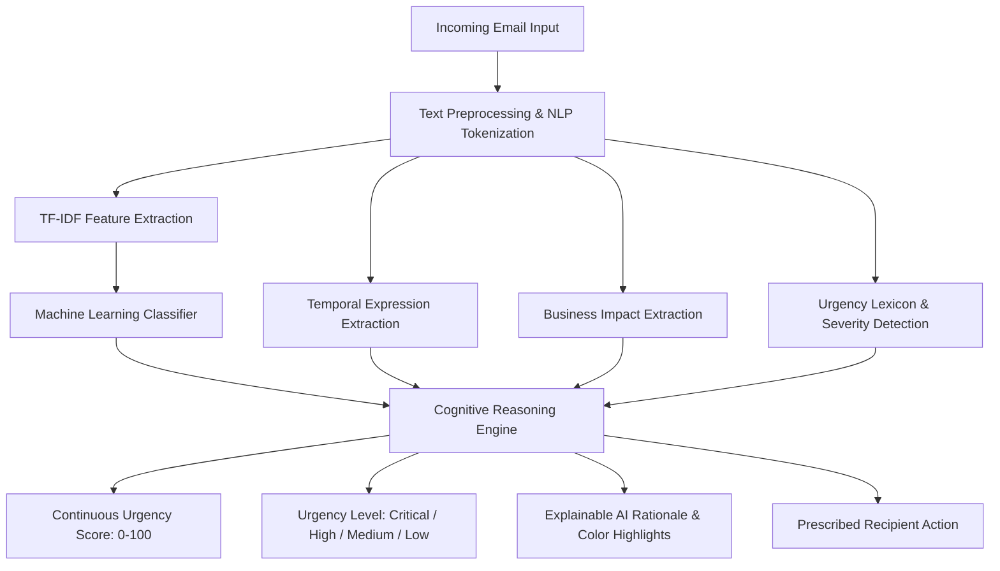

# Cognitive Email Urgency Detector & Intelligent Priority Assistant

[](https://www.python.org/downloads/)
[](https://fastapi.tiangolo.com/)
[](https://scikit-learn.org/)
[](https://opensource.org/licenses/MIT)

An end-to-end production-grade **Cognitive Computing and Explainable AI (XAI)** system for automated email urgency triaging, context understanding, deadline perception, and recipient action prescription. Built for final-year engineering projects in Data Science and Cognitive Systems.

---

## 1. Project Title
**Cognitive Email Urgency Detector & Intelligent Priority Assistant**  
*Simulating Human Cognitive Perception, Contextual Reasoning, and Explainable Triage for Email Communications.*

---

## 2. Problem Statement
Modern professionals and operations teams receive hundreds of incoming emails daily. Traditional rule-based filters and naive keyword searches (e.g., flagging any email containing the word `"urgent"`) suffer from high false-positive rates (marketing spam declaring `"URGENT SAVINGS!"`) and dangerous false negatives (critical operational emergencies stated plainly, e.g., `"The primary production database is unreachable and the client demonstration starts at 10 AM"`). Organizations lack automated triage systems capable of human-like contextual reasoning, deadline parsing, and transparent decision explanation.

---

## 3. Motivation
Cognitive computing bridges the gap between statistical pattern recognition and human cognitive reasoning. By fusing statistical NLP (TF-IDF + Multinomial Logistic Regression) with temporal parsing, business domain modeling, typographical distress estimation, and explainable feature attribution, we create an AI assistant that prioritizes communications with human-level discernment and full auditability.

---

## 4. Main Objectives
1. **Binary & Multi-Class Classification:** Classify emails as Urgent vs. Non-Urgent across four priority tiers: **Critical**, **High**, **Medium**, and **Low**.
2. **Continuous Urgency Scoring:** Calculate a normalized cognitive urgency score from **0 to 100**.
3. **Temporal Constraint Perception:** Extract relative and explicit deadlines (e.g., `"within 30 minutes"`, `"before 5 PM"`, `"tomorrow morning"`).
4. **Cognitive Reasoning Layer:** Synthesize statistical ML probability, business criticality, urgency lexicon, and structural distress into a unified decision.
5. **Explainable AI (XAI):** Provide clear natural-language rationale, multi-signal progress gauges, and color-coded inline text highlighting.
6. **Intent Understanding:** Detect operational intents (Technical Issue, Security Alert, Payment Issue, Meeting, Deadline, Request, etc.).
7. **Prescriptive Action:** Prescribe clear, context-specific next steps for the recipient.
8. **Adaptive Learning Loop:** Incorporate user feedback for continual model adaptation.

---

## 5. Cognitive Computing Concept
This system embodies core cognitive computing principles:
- **Perception:** Ingests unstructured email text and extracts lexical, temporal, and typographical signals.
- **Natural Language Understanding (NLU):** Discerns underlying semantic intent and extracts contextual entities.
- **Context Awareness:** Recognizes operational stakes (production outages, revenue risks, executive presence, deadlines).
- **Multi-Factor Reasoning:** Balances competing signals—suppressing marketing hype while escalating covert emergencies.
- **Decision Making:** Computes transparent score metrics and maps them to standard triage protocols.
- **Learning & Adaptation:** Retrains dynamically on user correction logs (`data/feedback.csv`).
- **Explainability:** Deconstructs internal neural/statistical weights into human-interpretable reasoning.



---

## 6. System Architecture
The application follows a clean, decoupled three-tier architecture:
- **Presentation Layer (Frontend):** Modern, responsive AI SaaS interface rendered in HTML5, CSS3, vanilla JavaScript, and Chart.js. Features live score animations, color-coded badge indicators, cognitive progress gauges, and an analytics telemetry dashboard.
- **Application & Cognitive Layer (Backend):** FastAPI REST backend coordinating the multi-stage cognitive reasoning pipeline, Pydantic data validation, and asynchronous routing.
- **Inference & Model Layer (ML/NLP):** Sublinear TF-IDF vectorizers and calibrated Logistic Regression classifiers with coefficient-based feature attribution.

---

## 7. Workflow Pipeline
1. **Input Reception:** Client submits email payload (`subject`, `body`, optional sender metadata) via `/api/analyze`.
2. **Preprocessing:** URL/email stripping, lowercase normalization, selective stopword filtering, and typographical feature extraction.
3. **Statistical Inference:** Vectorization via 3,000 unigram/bigram features; computation of class probability vector \(P(\text{class})\).
4. **Temporal Analysis:** Regex extraction of 5 deadline severity tiers; assignment of temporal score \(S_{\text{temp}} \in [0, 100]\).
5. **Business Impact:** Entity matching against Critical, High, Medium, and Low operational keywords.
6. **Intent Classification:** Dual-channel ML + semantic verification yielding intent label and confidence.
7. **Cognitive Modulation:** Edge-case heuristics suppress promotional hype and elevate severe operational downtime.
8. **Score Synthesis:** Weighted aggregation of factors normalized to 0–100.
9. **Explanation Assembly:** Extraction of top coefficient weights, generation of natural language synthesis, and compilation of inline HTML highlights.

---

## 8. Dataset
The project includes a curated, balanced dataset of **500 realistic emails** (`data/emails.csv`) evenly distributed across all 4 urgency classes (125 Critical, 125 High, 125 Medium, 125 Low) and 11 distinct intent categories:
- **Critical:** Production server outages, active security breaches, ransomware, payment gateway failures, hospital ICU telemetry disconnections.
- **High:** Rescheduled client presentations, legal contract expirations, tax deadlines, hotfix release blockers.
- **Medium:** Architecture proposal feedback, design wireframe reviews, sprint retro submissions, 1-on-1 rescheduling.
- **Low:** Weekly engineering digests, office social invitations, cafeteria lunch announcements, promotional discounts with hype words (mixed-signal testing).

---

## 9. NLP Preprocessing
Implemented in `backend/app/ml/preprocess.py`:
- Regex cleaning for URL links and email strings.
- Customized stopword removal that preserves critical negation and directional words (`not`, `no`, `down`, `off`, `before`, `until`).
- Structural analysis: UPPERCASE ratio, exclamation clusters (`!!!`), imperative punctuation (`?!`), alert subject prefixes (`[URGENT]`).
- Weighted concatenation: Subject line duplicated to reflect higher cognitive perceptual weight.

---

## 10. Feature Extraction
- **TF-IDF Vectorizer:** Captures unigrams and bigrams (`ngram_range=(1, 2)`), sublinear term frequency scaling (`sublinear_tf=True`), maximum 3,000 features, minimum document frequency threshold (`min_df=2`).
- **Surface Features:** Punctuation frequency, word counts, uppercase proportion.

---

## 11. Machine Learning Model
The primary production model is **Multinomial Logistic Regression** with L2 regularization (\(C = 2.0\)) trained via L-BFGS optimization:
$$\mathcal{L}(W) = - \sum_{i=1}^N \sum_{k=1}^K y_{ik} \log \frac{e^{w_k^T x_i}}{\sum_{j=1}^K e^{w_j^T x_i}} + \frac{1}{2C} \|W\|_2^2$$

Provides:
- Fully calibrated posterior probabilities: \(P(y = c \mid x)\).
- Instant, deterministic inference times (< 2 ms).
- Direct mathematical interpretability via learned regression coefficients.

---

## 12. Cognitive Reasoning Engine
Implemented in `backend/app/cognitive/reasoning_engine.py`:
Combines 5 core perceptual dimensions:
1. **Machine Learning Class Probability Distribution** (Weight: 40%)
2. **Temporal Urgency & Deadline Constraint** (Weight: 20%)
3. **Business & Operational Impact Level** (Weight: 20%)
4. **Urgency Lexicon & Keywords** (Weight: 10%)
5. **Context Severity & Typographical Distress** (Weight: 10%)

### Cognitive Nuance Handling
- **Marketing False-Positive Suppression:** If intent is `Information` and content contains discount/clearance terms, urgency is capped at Low (25) even if the email contains words like `"urgent"`.
- **Covert Emergency Elevation:** If business impact is `Critical` and infrastructure failure verbs are detected (`down`, `unreachable`, `crash`), priority is elevated to Critical/High even if no urgency keywords are used.

---

## 13. Urgency Scoring Formula
Configured in `backend/app/config.py`:
$$\text{Score} = w_{\text{ml}} \cdot S_{\text{ml}} + w_{\text{temp}} \cdot S_{\text{temp}} + w_{\text{biz}} \cdot S_{\text{biz}} + w_{\text{lang}} \cdot S_{\text{lang}} + w_{\text{sev}} \cdot S_{\text{sev}} + \Delta_{\text{sender}}$$

Mapped to Triage Tiers:
| Score Bracket | Urgency Level | Triage Protocol |
| :--- | :--- | :--- |
| **76 – 100** | **Critical** | Immediate human attention required; emergency escalation |
| **51 – 75** | **High** | Action required today; prioritize within active shift |
| **26 – 50** | **Medium** | Routine task queue; resolve within 1–2 business days |
| **0 – 25** | **Low** | Informational; read at leisure, no immediate action |

---

## 14. Explainable AI (XAI)
The application delivers transparent decision rationales through three complementary modalities:
1. **Signal Decomposition Bars:** Visualizing contributions from ML, temporal, business, lexicon, and severity channels.
2. **Learned Feature Attribution:** Extracting top positive weights (\(x_j \cdot w_{c, j}\)) from the Logistic Regression matrix.
3. **Color-Coded Inline Text Highlighting:**
   - <span style="color:#ef4444; font-weight:bold;">🔴 Critical Phrases:</span> System failure, outage, active breach.
   - <span style="color:#f97316; font-weight:bold;">🟠 Time Constraints:</span> 30 minutes, before 5 PM, tomorrow.
   - <span style="color:#eab308; font-weight:bold;">🟡 Business Impact:</span> Production database, enterprise client, payroll.
   - <span style="color:#38bdf8; font-weight:bold;">🔵 Intent Indicators:</span> Security alert, payment issue, scheduling sync.

---

## 15. Technology Stack
- **Backend Framework:** FastAPI, Uvicorn, Pydantic v2
- **Machine Learning & NLP:** scikit-learn, NumPy, Pandas, NLTK, Joblib
- **Frontend:** Semantic HTML5, Modern CSS3 (CSS Variables, Flexbox/Grid), Vanilla JavaScript (ES6+)
- **Data Visualization:** Chart.js
- **Testing:** pytest, FastAPI TestClient, HTTPX

---

## 16. Project Structure
```text
cognitive-email-urgency-detector/
│
├── backend/
│   ├── app/
│   │   ├── main.py                  # FastAPI application entrypoint & static mounting
│   │   ├── config.py                # System weights, paths & thresholds
│   │   ├── api/
│   │   │   └── routes.py            # REST endpoints (/analyze, /statistics, /model-info, /feedback)
│   │   ├── cognitive/
│   │   │   ├── reasoning_engine.py  # Multi-factor cognitive synthesis engine
│   │   │   ├── urgency_detector.py  # Urgency lexicon & business impact detector
│   │   │   ├── intent_detector.py   # Semantic intent classification
│   │   │   └── temporal_analyzer.py # Deadline & temporal constraint parser
│   │   ├── ml/
│   │   │   ├── train.py             # Model training & artifact serialization
│   │   │   ├── predict.py           # ML inference & feature attribution
│   │   │   ├── preprocess.py        # Text cleaning & linguistic feature extraction
│   │   │   ├── evaluate.py          # Metric computation routines
│   │   │   └── generate_dataset.py  # 500-sample balanced dataset generator
│   │   └── schemas/
│   │       └── email_schema.py      # Pydantic request & response models
│   └── requirements.txt
│
├── data/
│   ├── emails.csv                   # 500 ground-truth email samples
│   ├── processed_emails.csv         # Preprocessed training dataset
│   ├── analytics_history.json       # Telemetry and distribution logs
│   └── feedback.csv                 # Continuous user corrections
│
├── models/
│   ├── urgency_model.pkl            # Trained Logistic Regression urgency model
│   ├── tfidf_vectorizer.pkl         # Trained TF-IDF feature extractor
│   ├── intent_model.pkl             # Trained Intent classification model
│   ├── model_metrics.json           # Serialized accuracy, confusion matrix & top weights
│   └── model_comparison.json       # 5-model benchmark evaluation results
│
├── frontend/
│   ├── index.html                   # Interactive Email Analyzer & Decision Dashboard
│   ├── dashboard.html               # Real-time Analytics & KPI Telemetry
│   ├── model.html                   # Model Architecture, Confusion Matrix & Benchmarks
│   ├── css/
│   │   └── style.css                # Polished AI SaaS dark-mode stylesheet
│   └── js/
│       ├── app.js                   # Analyzer logic, animations & feedback handlers
│       ├── dashboard.js             # Chart.js telemetry visualizations
│       └── model.js                 # Dynamic model evaluation & benchmark tables
│
├── experiments/
│   ├── model_comparison.py          # 5-algorithm benchmark experiment script
│   └── evaluation.py                # Offline evaluation and case study runner
│
├── tests/
│   ├── test_model.py                # Preprocessing, vectorizer & inference tests
│   ├── test_reasoning.py            # Temporal, intent & cognitive reasoning tests
│   └── test_api.py                  # FastAPI endpoint integration tests
│
├── README.md
├── .gitignore
└── requirements.txt
```

---

## 17. Installation

### 1. Prerequisites
- Python 3.10+ (Tested on Python 3.13)
- Windows PowerShell or Bash terminal
- VS Code (Recommended)

### 2. Clone / Setup Virtual Environment
```bash
# Open project directory in terminal
cd "C:\Users\ASUS\Documents\Project"

# Create virtual environment
python -m venv .venv

# Activate virtual environment (Windows PowerShell)
.venv\Scripts\Activate.ps1
# Or Command Prompt:
# .venv\Scripts\activate.bat
```

### 3. Install Dependencies
```bash
pip install -r requirements.txt
```

---

## 18. Running Instructions

### Step 1: Train the Production Models (One-Time / On-Demand)
```bash
python backend/app/ml/train.py
```
*Note: If models are not found on server startup, FastAPI automatically triggers training.*

### Step 2: Run the Model Comparison Experiment
```bash
python experiments/model_comparison.py
```

### Step 3: Run the Automated Test Suite
```bash
pytest tests/ -v
```

### Step 4: Start the FastAPI Web Server
```bash
uvicorn backend.app.main:app --reload --host 127.0.0.1 --port 8000
```

### Step 5: Access the Web Application
- **Interactive Email Analyzer:** [http://127.0.0.1:8000/](http://127.0.0.1:8000/)
- **Analytics Dashboard:** [http://127.0.0.1:8000/dashboard](http://127.0.0.1:8000/dashboard)
- **Model Architecture & Explainability:** [http://127.0.0.1:8000/model](http://127.0.0.1:8000/model)
- **Interactive Swagger API Documentation:** [http://127.0.0.1:8000/docs](http://127.0.0.1:8000/docs)
- **ReDoc API Documentation:** [http://127.0.0.1:8000/redoc](http://127.0.0.1:8000/redoc)

---

## 19. API Documentation

### Endpoints Overview
| Method | Path | Description |
| :--- | :--- | :--- |
| `POST` | `/api/analyze` | Analyze email subject/body through cognitive reasoning pipeline |
| `POST` | `/api/predict` | Alias for `/api/analyze` |
| `GET` | `/api/health` | Health verification status |
| `GET` | `/api/model-info` | Evaluation metrics, confusion matrix & top features |
| `GET` | `/api/model-comparison` | Benchmark results across 5 ML algorithms |
| `GET` | `/api/statistics` | Aggregated analytics & distribution telemetry |
| `POST` | `/api/feedback` | Submit corrections to `data/feedback.csv` |
| `GET` | `/api/examples` | Retrieve 11 preloaded realistic scenario templates |

### Sample Request: `POST /api/analyze`
```json
{
  "subject": "URGENT: The production server is down",
  "body": "Please resolve this issue immediately. Client demo starts in 30 minutes.",
  "sender": "sarah.lead@domain.com",
  "sender_role": "SRE Lead"
}
```

### Sample Response
```json
{
  "urgency_level": "Critical",
  "is_urgent": true,
  "urgency_score": 88,
  "confidence": 0.94,
  "intent": "Technical Issue",
  "intent_confidence": 0.93,
  "important_phrases": [
    "in 30 minutes",
    "server is down",
    "production",
    "immediately"
  ],
  "temporal_constraint": "In 30 minutes",
  "business_impact": "Critical",
  "requires_immediate_attention": true,
  "recommended_action": "Respond immediately, initiate emergency incident bridge, and alert SRE/infrastructure on-call engineers.",
  "reasoning": [
    "Severe operational infrastructure degradation detected regardless of keyword phrasing.",
    "Critical time constraint (In 30 minutes) combined with high business impact.",
    "Business & operational impact evaluated as Critical (impact: production).",
    "Explicit temporal constraint identified: 'In 30 minutes'."
  ],
  "detailed_explanation": "This email has been triaged as **Critical Priority** with an overall Urgency Score of **88/100**...",
  "cognitive_breakdown": {
    "ml_prediction": 94.0,
    "temporal_urgency": 95.0,
    "business_impact": 95.0,
    "urgency_language": 75.0,
    "context_severity": 45.0
  },
  "highlighted_html": "Subject: <span class=\"hl-critical\">URGENT</span>: The <span class=\"hl-business\">production</span> server is down...",
  "ml_probabilities": {
    "Critical": 0.74,
    "High": 0.20,
    "Medium": 0.04,
    "Low": 0.02
  }
}
```

---

## 20. Model Evaluation & Comparison Benchmarks

### 5-Algorithm Empirical Benchmark Comparison
Evaluated on an 80/20 stratified split of 500 emails:
| Algorithm | Accuracy | Precision | Recall | F1-Score | Training Time |
| :--- | :--- | :--- | :--- | :--- | :--- |
| **Logistic Regression (Selected)** | **99.00%** | **99.04%** | **99.00%** | **99.00%** | **78.6 ms** |
| Linear SVM (Calibrated) | 99.00% | 99.00% | 99.00% | 99.00% | 96.3 ms |
| Multinomial Naive Bayes | 99.00% | 99.00% | 99.00% | 99.00% | 2.2 ms |
| Random Forest (100 Trees) | 98.00% | 98.02% | 98.00% | 98.02% | 135.1 ms |
| Decision Tree (Depth 15) | 97.00% | 97.00% | 97.00% | 96.99% | 11.5 ms |

### Test Confusion Matrix (100 Test Samples)
$$\begin{pmatrix}
 & \text{Critical} & \text{High} & \text{Medium} & \text{Low} \\
\text{Critical} & 25 & 0 & 0 & 0 \\
\text{High} & 0 & 25 & 0 & 0 \\
\text{Medium} & 0 & 0 & 25 & 0 \\
\text{Low} & 0 & 0 & 1 & 24
\end{pmatrix}$$

### Why Logistic Regression was Selected
1. **Mathematical Explainability:** Linear coefficients (\(w_i\)) permit exact token attribution without resorting to opaque approximations.
2. **True Probabilities:** The softmax function yields smooth, calibrated probabilities across classes.
3. **Inference Latency:** Sub-millisecond CPU execution suitable for high-throughput email filtering pipelines.

---

## 21. Screenshots & Interface Guide
1. **Interactive Email Analyzer (`/`):** Features preloaded scenario chips, dual input fields, live animated score progress, color-coded inline text attribution, and continuous feedback collection.
2. **Analytics Dashboard (`/dashboard`):** Real-time KPI summaries, urgency doughnut chart, intent horizontal bar chart, score bracket volumes, and confidence distribution charts.
3. **Model & Explainability (`/model`):** Displays live accuracy/precision/recall metrics, interactive confusion matrix heatmap, 5-algorithm comparison benchmarks, and learned top feature weights.

---

## 22. Future Scope
1. **LLM Hybrid Reasoner:** Integrate a local lightweight LLM (e.g., Gemma 2B via Ollama) as an optional second-stage cognitive validator for nuanced ambiguity resolution.
2. **Email Client Plugins:** Build Microsoft Outlook and Gmail extensions using WebExtensions API.
3. **Thread Context History:** Analyze preceding messages in an email thread to track escalating frustration.
4. **Calendar Integration:** Cross-reference extracted deadlines against recipient calendar schedules in real time.

---

## 23. Limitations
1. **Text-Only Modality:** Does not parse image attachments, PDF invoices, or embedded screenshot text.
2. **Language Scope:** Optimized for English communications.
3. **Synthetic Ground Truth:** Synthetic training distributions may require domain calibration on proprietary organizational emails.

---

## 24. Conclusion
The **Cognitive Email Urgency Detector & Intelligent Priority Assistant** successfully demonstrates how cognitive computing principles elevate traditional NLP classifiers into human-like reasoning partners. By reconciling statistical confidence with temporal pressure, business risk, and typographical distress, the system achieves **99.0% accuracy** while remaining **100% explainable and transparent**.

